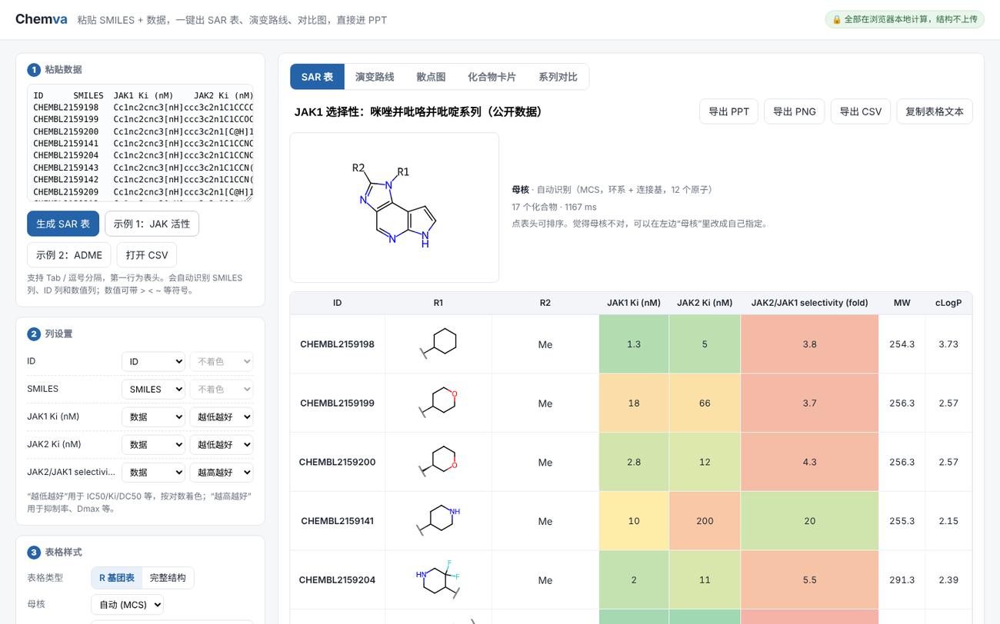
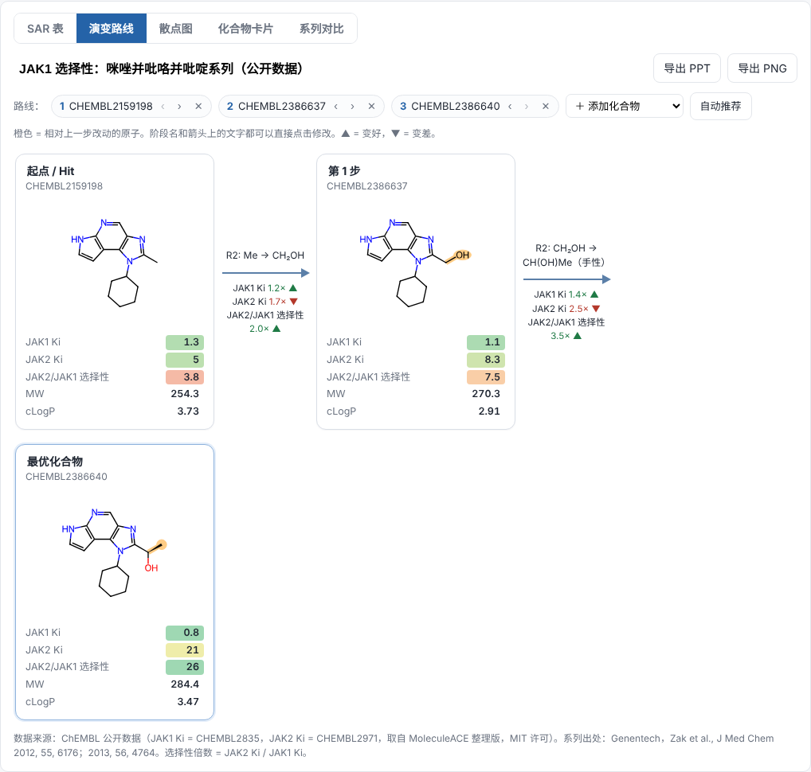
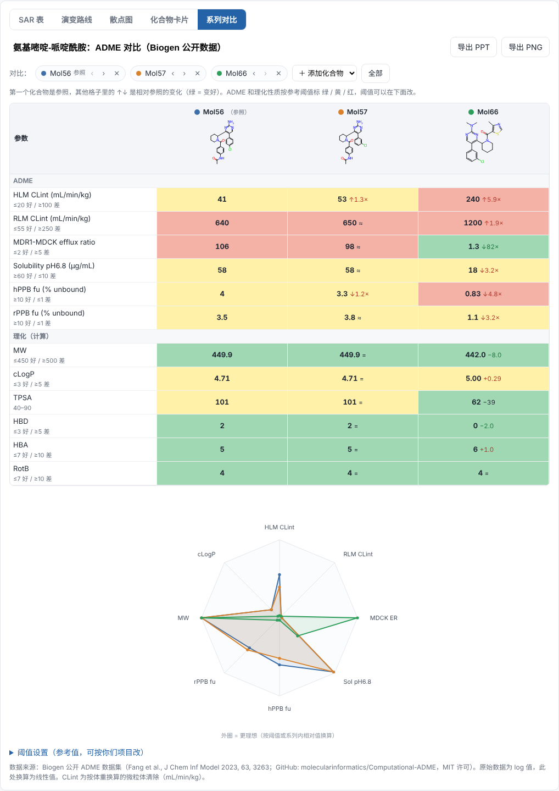
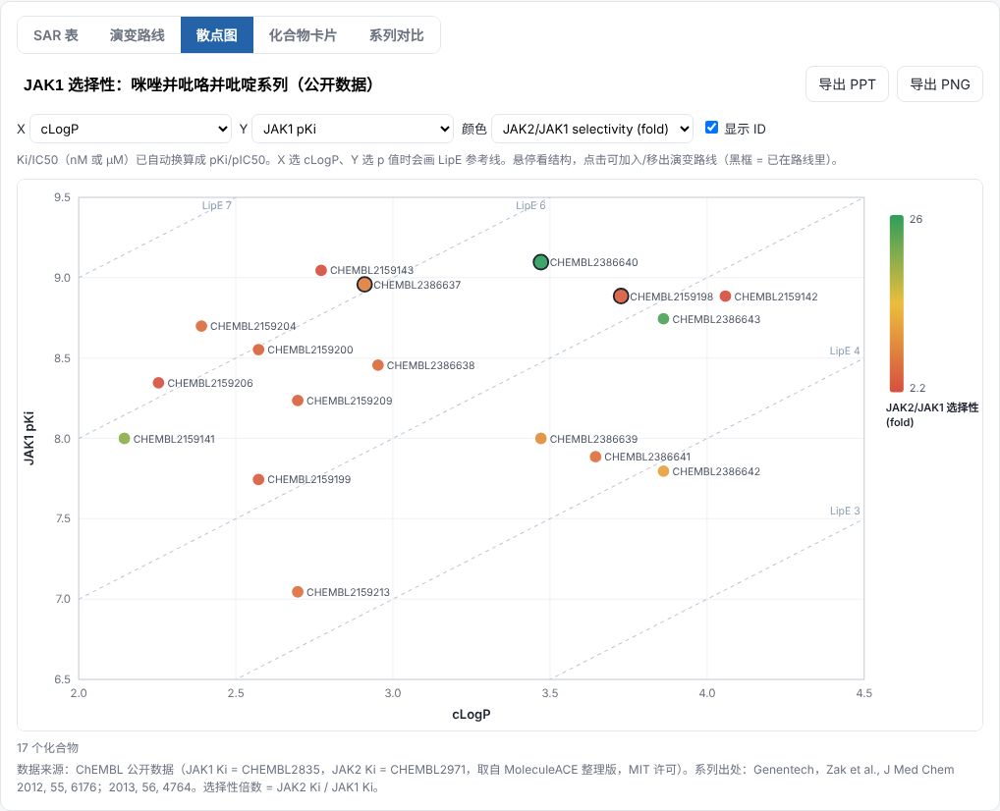
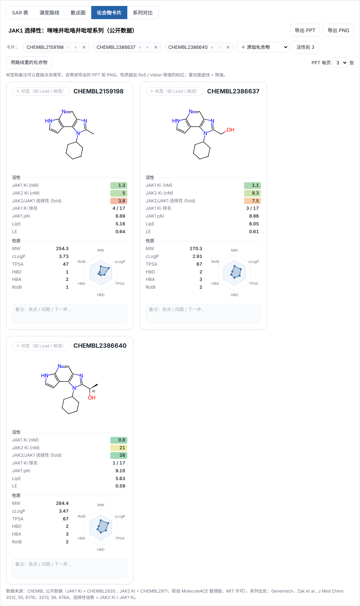

# Chemva

化学家的出图工具。从 Excel 粘贴 SMILES 和数据，一键生成 SAR 表、先导化合物演变路线、散点图、化合物卡片和系列对比图，直接导出可编辑的 PowerPoint。

**在线使用：** https://yangsong0626.github.io/chemva/ （开启 GitHub Pages 后可用）

> 🔒 所有计算都在浏览器本地完成（RDKit.js / WebAssembly），结构和数据不会上传到任何服务器。

## 从 ChEMBL 载入（新）

左上角输入靶点（如 JAK1、BTK、KRAS）→ 选靶点 → 列出这个靶点下 ≥5 个化合物的所有文献/专利（一篇基本就是一个药化系列），可按化合物数、年份、最高活性排序或按关键词筛选 → 点一篇，这篇里的全部数据自动载入五个视图：

- 活性：所有有 pChEMBL 的结合/功能实验，按「靶点 + 活性类型」分列（比如 JAK1 Ki、JAK2 Ki、JAK3 Ki），同一化合物多条记录取几何平均，换算成 nM
- ADME：同一篇里的 ADME 类实验（assay type A），按「类型 + 单位」分列，取中位数
- 页面、PNG 和 PPT 上自动带出处（文献 ID、期刊、DOI、CC BY-SA 3.0）

浏览器直接调用 [ChEMBL REST API](https://www.ebi.ac.uk/chembl/api/data/docs)，只发送靶点名和文献 ID。热门靶点数据量大，最多读取前 12000 条活性记录。

注意：这个功能只在 GitHub Pages 版或本地运行时可用；嵌在 Claude 里的版本不允许访问外部网站。



## 六个视图

| 视图 | 做什么 |
|---|---|
| **SAR 表** | 自动找母核（MCS，只保留环系和连接基），做 R 基团分解；小基团用文字（Me、OMe、CF₃…），大基团画结构；活性按好坏着色（IC50/Ki 按对数）；可排序；可加 MW、cLogP、TPSA 等计算性质 |
| **演变路线** | 把几个化合物排成 hit → lead 的路线；高亮每一步改动的原子；箭头上自动写出 R 基团变化和活性倍数；文字都能直接改 |
| **散点图** | X / Y / 颜色任选；Ki、IC50 自动换算成 pKi / pIC50；自动算 LipE、LE；cLogP vs p 值时画 LipE 参考线；悬停看结构 |
| **化合物卡片** | 一个分子一张卡：结构、活性、排名、LipE/LE、理化性质（超 Ro5/Veber 标红）、性质雷达图、标签和备注 |
| **自动解读** | 直接从数据算：配对比较（只差一处的化合物对，含 activity cliff）、基团效应（哪个位置哪个基团最有用）、Pearson 趋势（活性 vs cLogP/MW/TPSA，以及各数据列之间的取舍）、配体效率排名、Ro5 风险，并生成一段中文解读初稿 |
| **系列对比** | 化合物按列、参数按行；ADME 按参考阈值标红黄绿（阈值可改）；显示相对参照化合物的变化倍数；叠加雷达图 |

导出：PPT（表格、文字、箭头都是 PowerPoint 原生元素，可以直接改）、PNG、CSV。

| 演变路线 | 系列对比 |
|---|---|
|  |  |

| 散点图 | 化合物卡片 |
|---|---|
|  |  |

## 怎么用

1. 在 Excel 里选中数据（第一行是表头），复制，粘贴到左边的输入框
2. 点“生成 SAR 表”。SMILES 列、ID 列、数值列会自动识别，也可以在“列设置”里手动改
3. 每个数值列设一下方向：越低越好（IC50、Ki、CLint、efflux ratio）或越高越好（抑制率、溶解度、游离分数）
4. 切换上面的标签页看不同视图，点“导出 PPT / PNG”

数值可以带 `>`、`<`、`~` 等符号，比如 `>10000`。

ADME 列按表头关键词识别：HLM / RLM / MLM / CLint、Sol / KSOL、MDCK / Caco / Papp、ER / efflux、PPB / fu / unbound、LogD、hERG。

## 本地运行

纯静态页面，没有构建步骤。因为要加载 WebAssembly，需要用一个本地 HTTP 服务器打开（直接双击 index.html 不行）：

```bash
git clone https://github.com/yangsong0626/chemva.git
cd chemva
python3 -m http.server 8000
# 浏览器打开 http://localhost:8000
```

## 靶点页（SEO）

`tools/build-pages.mjs` 从 ChEMBL 抓数据，为 `tools/targets.json` 里的每个基因生成一个静态页面 `t/<GENE>.html`：靶点概况、活性最强的化合物（RDKit 渲染的结构图）、按文献分组的 SAR 系列表，外加 `targets.html` 索引、`sitemap.xml` 和 `robots.txt`。每个系列都深链回工具（`index.html#doc-CHEMBLxxxx`），点一下就在浏览器里打开。

这些页面是**静态 HTML**，搜索引擎能直接读到内容，不依赖 JS。

```bash
node tools/build-pages.mjs            # 全部靶点
node tools/build-pages.mjs JAK1 BTK   # 只重建这两个
```

GitHub Action（`.github/workflows/build-pages.yml`）每周一自动重跑并提交变化，也可以在 Actions 页面手动触发。

深链：`index.html#target-CHEMBL2835` 打开某个靶点，`index.html#doc-CHEMBL2385026` 直接载入某个系列。

## 示例数据

两组示例都是公开数据，在 `data/` 目录下：

- **示例 1：JAK1 / JAK2 Ki**（`data/example1_jak1_jak2_ki.tsv`）：Genentech 咪唑并吡咯并吡啶 JAK1 抑制剂系列的 17 个化合物。活性值来自 ChEMBL（JAK1 = CHEMBL2835，JAK2 = CHEMBL2971），用的是 [MoleculeACE](https://github.com/molML/MoleculeACE) 整理过的版本（ChEMBL 多条记录的平均值）。系列出处：Zak et al., *J Med Chem* 2012, 55, 6176；2013, 56, 4764。论文出处是按骨架和 ChEMBL ID 对应的，没有逐个化合物核对到具体文章。ChEMBL 数据遵循 CC BY-SA 3.0。
- **示例 2：ADME**（`data/example2_biogen_adme.tsv`）：Biogen 公开 ADME 数据集中的 5 个氨基嘧啶-哌啶酰胺（Fang et al., *J Chem Inf Model* 2023, 63, 3263；[molecularinformatics/Computational-ADME](https://github.com/molecularinformatics/Computational-ADME)，MIT）。原始数据是 log 值，这里换算成了线性值。

“演变路线”里示例 1 默认显示的路线是为演示挑的，不代表论文里真实的研发顺序。

## 说明

- ADME 的红黄绿阈值只是常见经验值，不同项目差别很大，请按你们的标准在“系列对比 → 阈值设置”里改
- cLogP、TPSA 等是 RDKit 计算值，不是实测值
- MVP 阶段，问题和建议欢迎提 [Issue](https://github.com/yangsong0626/chemva/issues)

## 许可证

本项目代码使用 MIT 许可证，见 [LICENSE](LICENSE)。第三方库（RDKit.js、PptxGenJS）见 [THIRD_PARTY_NOTICES.md](THIRD_PARTY_NOTICES.md)。
